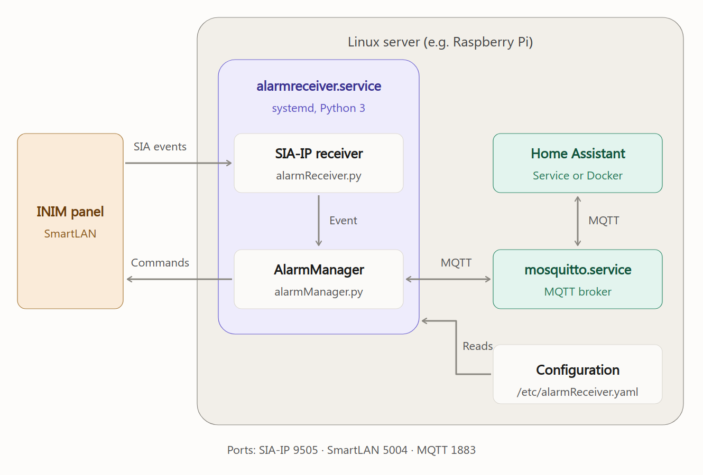

# alarmReceiver

Bridge tra una centrale antifurto **INIM SmartLeague** e **Home Assistant** (via MQTT).

Il progetto fa due cose:
1. **Riceve** gli eventi che la centrale invia in push tramite il protocollo **SIA-IP** (ASCII) e li ripubblica su MQTT.
2. **Comanda** la centrale (inserimento, disinserimento, stato, verifica zone, sincronizzazione oraria) tramite il **protocollo binario proprietario INIM** su TCP, ricostruito in reverse engineering con `sniffer.py`.

## Architettura


Sorgente modificabile: [`docs/architecture.svg`](docs/architecture.svg).

## Struttura progetto
- `alarmReceiver.py` — entry point: server TCP SIA-IP che riceve gli eventi dalla centrale. Avvia l'`AlarmManager`.
- `alarmManager.py` — cuore del progetto: client MQTT, esecutore comandi TCP binari, parsing SIA-IP, sincronizzazione oraria.
- `sniffer.py` — TCP proxy man-in-the-middle tra SmartLeague e la centrale per catturare il protocollo binario.
- `read_loop.py` — tool standalone: legge in loop l'ora dalla centrale e stampa il delta col server.
- `write_time.py` — tool standalone: scrive l'ora sulla centrale (sequenza completa 4 write), da usare con `read_loop.py` per verifica.
- `ADB.py` — (utility separata)
- `init.d_script/`, `systemd_script/` — script per l'avvio come servizio.

## Configurazione (`/etc/alarmReceiver.yaml`)
Fonte unica di configurazione (`AppConfig`, default `DEFAULT_PATH = /etc/alarmReceiver.yaml`).

```yaml
mqtt:
  broker: <host>
  port: 1883
  user: <user>
  password: <password>

alarm_system:
  ip: 192.168.0.125          # IP centrale INIM
  port: 5004                 # porta TCP protocollo binario INIM
  tz_offset_min: 60          # offset fuso in minuti (60 = UTC+1)
  timezone_name: "Europe/Rome"  # se presente gestisce CEST/CET; altrimenti usa il TZ di sistema
  time_sync_interval: 3600   # secondi tra i controlli di sincronizzazione oraria

server:
  port: <porta>              # porta su cui alarmReceiver ascolta gli eventi SIA-IP in push

commands:                    # comandi binari INIM (bytes hex, reverse-engineered) — vedi sotto
  - alarm_status: [{send: "...", expect: "..."}]
  - alarm_arm:      [ ... ]
  - alarm_arm_home: [ ... ]
  - alarm_disarm:   [ ... ]
  - zone_verify:    [ ... ]

zones:                       # mappa zone per zone_verify e per eventi DO/DR
  - {description: "...", topic: "alarm/zone/...", byte: <int>, value: <bitmask int>}
```
Il `security_code` è stato **rimosso**: questa centrale non richiede autenticazione per i comandi binari (in `write_time.py` resta come argomento opzionale di default `091204`, ma la riga di invio è commentata).

I comandi binari `alarm_status`, `alarm_arm`, `alarm_arm_home`, `alarm_disarm`, `zone_verify` sono **byte hex ricavati dallo sniffer** e vivono nello YAML come liste di step `{send, expect}`, non nel codice.

---

## Protocollo 1 — SIA-IP (eventi in ingresso, ASCII)

La centrale si connette al server (`alarmReceiver.py`, `AlarmTCPHandler`) e invia messaggi SIA-DCS in ASCII. Il server risponde ACK/NAK e passa il corpo all'`AlarmManager`.

### Frame
- Identificatore di protocollo: `"SIA-DCS"` (`ID_STRING`).
- I primi 4 caratteri del messaggio ricevuto sono il **CRC** in hex; il resto (da `"SIA-DCS"` in poi) è il corpo su cui si ricalcola il CRC per validare.
- **CRC-16** (`CRCCalc`): polinomio `0xA001`, shift a destra, XOR bit a bit; output 4 hex uppercase zero-padded. È il classico CRC-16/ARC (IBM).
- Risposta costruita: `"\n" + CRC(4 hex) + length(4 hex uppercase) + body + "\r"`.
  - Body ACK: `"ACK"` + seq(4) + `L0` + accountId + `[]`
  - Body NAK: `"NAK"0000L0R0A0[]` + timestamp `_%H:%M:%S,%m-%d-%Y` (mandato anche su CRC errato, così la centrale ripete l'invio).

Nota: la centrale in realtà non verifica il CRC della risposta (basterebbe `CRC="@?00"`), ma il codice lo calcola comunque correttamente.

### Parsing evento
Regex (`AlarmManager.alarmPattern`):
```
\[#[0-9]{6}\|....(..)([0-9]+)\^?([^\^]*)\^?\]
```
Estrae: **codice evento** (2 lettere), **parametro** (numero, es. progressivo zona), **descrizione** (testo).

Esempio messaggio:
```
"SIA-DCS"0714L0#001234[#001234|Nri0OP4^Sirena Interna  ^]_11:47:38,11-13-2025
```

### Tabella codici evento (`reactions`)
| Codice | Significato | Azione |
|--------|-------------|--------|
| `BA` | Allarme intrusione | stato → `triggered` |
| `TA` | Sabotaggio | stato → `triggered` |
| `CL` | Inserimento totale | stato → `armed_away` |
| `NL` | Inserimento parziale | stato → `armed_home` |
| `OP` | Disinserimento | stato → `disarmed` |
| `BR` | Ripristino allarme intrusione | rilegge stato centrale |
| `TR` | Ripristino sabotaggio | rilegge stato centrale |
| `DO` | Accesso aperto (zona) | pubblica `OPEN` sul topic zona |
| `DR` | Accesso chiuso (zona) | pubblica `CLOSED` sul topic zona |
| `AT` | Mancanza alimentazione | `alarm/power` → `OFF` |
| `AR` | Ripristino alimentazione | `alarm/power` → `ON` |
| `YM` | Corto/disconnessione batteria | notify |
| `YT` | Batteria inefficiente | notify |
| `YR` | Ripristino batteria | notify |
| `EM` | Scomparsa dispositivo | notify |
| `EN` | Ripristino scomparsa dispositivo | notify |
| `BB` | Esclusione zona | notify |
| `BU` | Ripristino esclusione | notify |
| `OU` | Malfunzionamento uscita | notify |
| `OV` | Ripristino malfunzionamento uscita | notify |
| `BC` | Reset memoria | notify |
| `JP` | Riconoscimento codice/chiave | notify |
| `DD` | Codice/chiave errati | notify |
| `LB` | Ingresso programmazione | notify |
| `LX` | Uscita programmazione | notify |
| `UX` | Non definito | nessuna |

**Quirk SmartLeague zone (`DO`/`DR`)**: i codici evento attivazione/disattivazione non sono affidabili; ciò che conta è il **parametro = progressivo della finestra/zona a partire da 1** (indice `param-1` nella lista `zones`).

---

## Protocollo 2 — INIM binario (comandi in uscita, TCP)

`TcpCommandExecutor` apre una connessione TCP a `alarm_system.ip:port`, invia una sequenza di step e confronta la risposta con `expect` (`"*"` = qualsiasi, `""` = nessuna risposta attesa). `TIMEOUT_SEC = 2`, `DELAY_BETWEEN = 0.5s` tra gli step.

### Struttura frame (8 byte header)
| Byte | Significato |
|------|-------------|
| 0 | comando: `0x00` = READ, `0x01` = WRITE |
| 1 | `0x00` (costante) |
| 2-3 | indirizzo 16-bit **big-endian** |
| 4 | `d0` — dato/parametro principale |
| 5 | `d1` — secondo parametro (spesso `0x00`) |
| 6 | `d2` — lunghezza/tipo del payload che segue |
| 7 | **checksum** = somma dei byte 0-6 modulo 256 (`sum(b) & 0xFF`) |
| 8+ | payload (solo nei WRITE) |

- **READ**: 8 byte, nessun payload. La risposta contiene i dati richiesti.
- **WRITE**: header 8 byte + payload. Es. `write12` mette 4 byte di payload (timestamp LE32); `write_short` mette N byte letterali.

### Lettura stato allarme (`alarm_status`)
La risposta viene decodificata così:
| Risposta | Stato |
|----------|-------|
| `0x00 0x00` | `armed_away` |
| `0x01 0x01` | `armed_home` |
| `0x02 0x02` | `disarmed` |

### Verifica zone (`zone_verify`)
La risposta è un buffer di byte; per ogni `Zone` configurata si testa `response[zone.byte] & zone.value != 0` → zona aperta. Le zone aperte vengono pubblicate su `alarm/attributes` come JSON `{"errors": "..."}` (o `"OK"`).

---

## Sincronizzazione oraria (protocollo set-time INIM)

Ricavata dagli sniff SmartLeague `20260612_192148` + `20260613_020048`.

### Rappresentazione tempo
- Timestamp = secondi **LE32** dal `01/01/2000 00:00:00` in **ora locale** (non UTC).
- Fuso orario: offset in minuti nel byte `d0` del comando 0x000D (es. `60` per UTC+1 → `0x3c`).
- Weekday = **`now.weekday()` 0-based** (Lun=0 … Sab=5 … Dom=6), come usa SmartLeague. **NON usare `isoweekday()`**: dava Sab=6 e il commit falliva silenziosamente. (⚠️ i commenti in `write_time.py:88` e `_buildSetTimeSteps` lo chiamano impropriamente "ISO"/"weekday" ma il valore inviato è sempre 0-based.)
- Nel codice di produzione si somma `REBOOT_DELAY_SEC = 8` al timestamp, così che dopo il riavvio della centrale (~8s) l'ora risulti già corretta.

### Sequenza — le 4 write sono tutte necessarie e sufficienti
La write 3 (`0x0172`, anno) triggera un **reboot immediato** della centrale (~7.5–8s); dopo il reboot carica dalla NVRAM il valore staged (commit avvenuto).

| # | Cmd   | Addr   | d0                   | d1   | d2   | Payload      |
|---|-------|--------|----------------------|------|------|--------------|
| 1 | WRITE | 0x000D | tz_offset_min (0x3c) | 0x00 | 0x04 | ts_le32 (4B) |
| 2 | WRITE | 0x0165 | month                | 0x00 | 0x04 | ts_le32 (4B) |
| 3 | WRITE | 0x0172 | year - 1990          | 0x00 | 0x01 | 0x04         |
| 4 | WRITE | 0x0040 | weekday() 0-based    | 0x00 | 0x02 | 0x00 0x00    |

(l'anno è codificato come `year - 1990`, coerentemente in `alarmManager.py` e `write_time.py`.)

### Condizioni per il commit riuscito (verificate empiricamente)
1. Solo le 4 write bastano — login read e read preparatorie **non** necessarie.
2. `weekday` = `now.weekday()` (0-based, Lun=0, Sab=5, Dom=6).
3. Connessione tenuta **aperta ≥ 1s** dopo l'ultimo ACK (`final_delay=1.0`). Con `sleep(0.5)` il commit in NVRAM non avveniva. Questo è il fattore critico.

### Lettura ora (`_readPanelTime` / `read_loop.py`)
Comando READ:
```
00 00 00 0D <tz_byte> 00 04 <chk>
```
Risposta = timestamp **LE32** (secondi dal 01/01/2000, ora locale) + eventuale checksum. Si leggono i primi 4 byte.

### Login / letture preparatorie (osservate, non necessarie)
Documentate in `write_time.py` (righe commentate) come parte della sequenza originale SmartLeague, ma **non richieste** per il commit:
```
read 0x0040 d0=0x00 len=0x0c   (login)
read 0x000D d0=0x7d len=1
read 0x0139 d0=0x7b len=6
read 0x000D d0=0x28 len=2
```

### Sincronizzazione condizionale (`_conditionalSetTime`)
Il set-time periodico avviene solo se:
1. l'allarme è **disarmato** (evita interruzioni durante l'inserimento);
2. la deriva rispetto all'ora corrente è **> 60s** (evita scritture EEPROM inutili).

Thread dedicati: `time-sync` (intervallo `time_sync_interval`) e `periodic-check` (ogni 600s: rilegge stato e, se disarmato, verifica zone).

---

## MQTT — topic verso Home Assistant

| Topic | Payload |
|-------|---------|
| `alarm/state` | `disarmed` \| `armed_away` \| `armed_home` \| `triggered` |
| `alarm/power` | `ON` \| `OFF` |
| `alarm/notify` | subject dell'evento (notifiche informative) |
| `alarm/attributes` | JSON `{"errors": "OK" \| "zona1, zona2, ..."}` |
| `alarm/command` | **ingresso** da HA: `DISARM` \| `ARM_AWAY` \| `ARM_HOME` |

- Tutti i publish sono con `retain=True`.
- `ARM_AWAY`: prima `zone_verify` (annulla se zone aperte), poi `alarm_arm`.
- `ARM_HOME`: `alarm_arm_home` diretto (nessuna verifica zone).
- Lo stato definitivo dopo arm/disarm arriva comunque dall'evento SIA-IP corrispondente (`CL`/`OP`).

---

## Reverse engineering — come si cattura il protocollo
```bash
python3 sniffer.py --alarm-ip <IP_CENTRALE> --alarm-port <PORTA> [--listen-port 10001]
```
Poi in SmartLeague punta la connessione a `127.0.0.1:<listen-port>` (o all'IP di questa macchina) ed esegui l'operazione da catturare. Lo sniffer logga hex+ascii in `sniffer_<timestamp>.log`.

Verifica set-time:
```bash
python3 read_loop.py 192.168.0.125 5004     # in un terminale: mostra il delta
python3 write_time.py 192.168.0.125 5004     # in un altro: scrive l'ora
```
